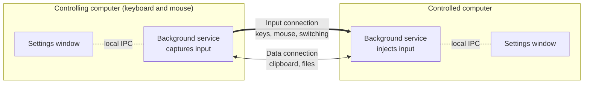
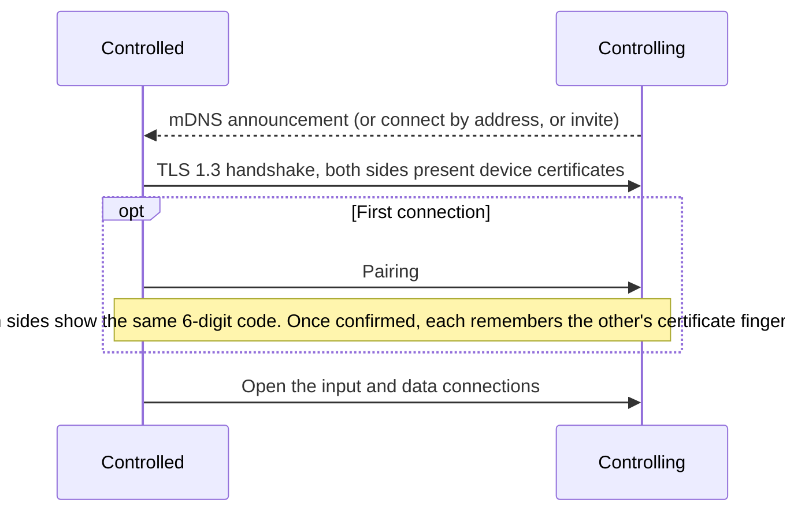
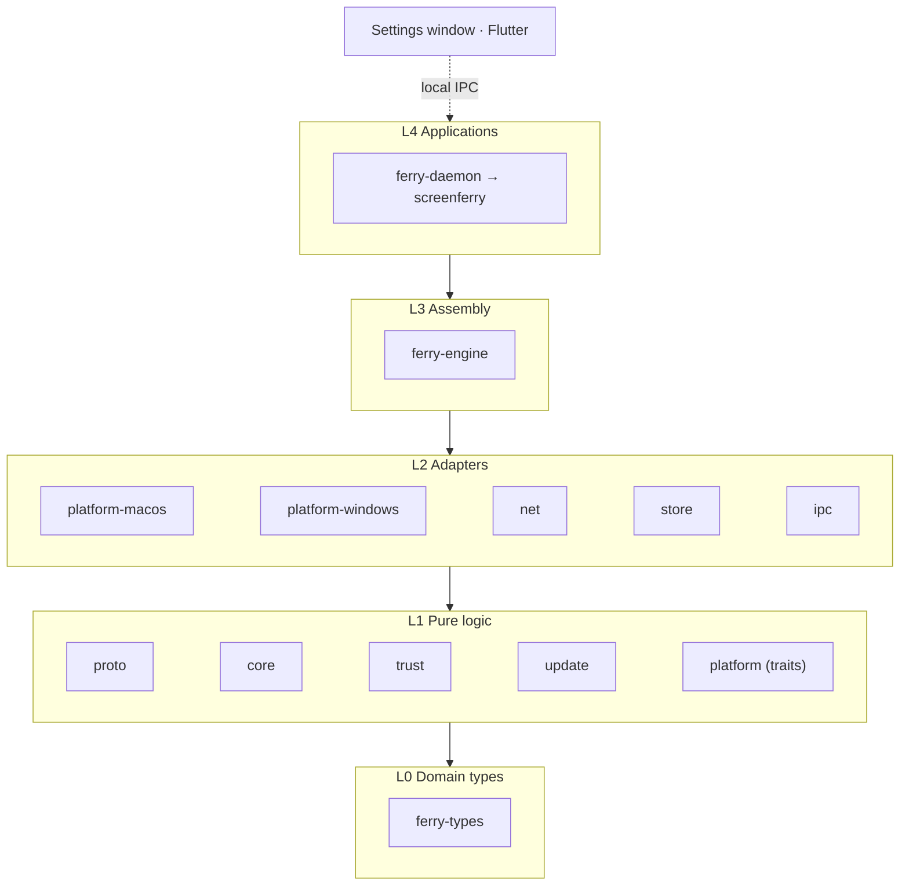

# FerryDesk

Keyboard, mouse and display collaboration.

[](https://github.com/ccdalao/FerryDesk/actions/workflows/ci.yml)
[](#license)

English | [简体中文](README.zh-CN.md)

FerryDesk connects keyboards, mice and displays across computers. It shares input between Mac and Windows machines, syncs the clipboard, sends files, and turns either computer into a true extended display over TLS 1.3. The daemon commands and data directories keep the ScreenFerry name so existing installations upgrade cleanly.

Maintained by [ccdalao](https://github.com/ccdalao), based on [ScreenFerry](https://github.com/icloudza/screen-ferry), with Apollo and Moonlight media components. See [credits and licensing](docs/credits.md).

## Features

- **Keyboard and mouse sharing**: push the cursor off a screen edge to move to the next computer. Keys travel as physical keys, so keyboard layouts and input methods don't get in the way. Caps Lock stays in sync and media keys are forwarded.
- **Many computers, either direction**: any computer can be the controlling one, and one can control several, arranged on any side.
- **Clipboard**: plain text, formatted text and images, synced when the cursor moves over.
- **Files**: drag them to a screen edge to send. Interrupted transfers resume after reconnecting.
- **Windows display extension**: reuse the existing pairing to extend either PC, pause or resume the extension, and stream audio. When audio is enabled, extending the controller onto the controlled PC plays controller audio through the controlled PC's default speakers; the reverse direction works the same way. While extension is active, its viewer owns pointer input. Stopping it restores ordinary keyboard and mouse sharing.
- **Per-device settings**: pointer speed (DPI), scroll direction and speed, modifier keys and key mappings, accidental-switch protection.
- **Secure**: confirm a 6-digit pairing code the first time, then only the paired certificate fingerprint is trusted.
- **Easy to connect**: automatic discovery on the local network. Where discovery is blocked, connect by address or invite from the controlling computer.
- **Lightweight**: a Rust background service in the tray. The settings window starts on demand and exits when closed.
- **Automatic updates**: checks once a day, downloads in the background, and installs when you choose Restart to Update. Every update is signature-checked first.
- **English and Chinese**: the settings window, tray menu and installer come in English and Simplified Chinese. They follow the system language, and you can switch in Settings → Appearance.

## How it works



Each computer runs a background service that captures or injects input and handles networking and sync. The settings window is a separate process that talks to it over loopback.
Each pair of devices keeps two TLS 1.3 connections, so a large file transfer never slows down the keyboard and mouse.

Trust is set up on the first connection:



## Install

| System | How |
|---|---|
| macOS | Download `ScreenFerry-<version>-macos-universal.dmg` from [Releases](https://github.com/ccdalao/FerryDesk/releases/latest), open it and drag ScreenFerry into Applications. On first launch, allow ScreenFerry in System Settings → Privacy & Security → Accessibility. |
| Windows | Download `FerryDesk-<version>-windows-x64-setup.exe` from [Releases](https://github.com/ccdalao/FerryDesk/releases/latest) and run it. |

ScreenFerry checks for updates once a day and downloads them in the background. Choose Restart to Update when it suits you; you can turn automatic checks off in Settings → About. Updates are verified against a built-in signing key before anything is installed.

About the Windows installer:

- It isn't code-signed. If SmartScreen blocks it, choose More info → Run anyway.
- It installs into Program Files by default (you can pick another drive) and allows ScreenFerry through the firewall on private and domain networks.
- The installer has an optional task, off by default: “Allow paired computers to control Windows permission prompts (UAC)”. It installs a system service that only handles keyboard and mouse, so the other computer can operate permission prompts, the lock screen and programs running as administrator. Besides pairing, an administrator must authorize that computer separately. Network connections, clipboard and files stay in the normal user process.
- Updates install silently after one administrator prompt. Without secure input, use this computer's own keyboard and mouse to approve it. Uninstall from Settings → Apps; your settings and pairings are kept.

## Usage

1. Open ScreenFerry on both computers. By default a Mac controls and a Windows PC is controlled; change this in Settings → This Computer. When both computers run the same system, set the one without the keyboard and mouse to Be Controlled.
2. On the controlled computer, choose the controlling one on the Devices page and confirm the 6-digit pairing code on both sides. If it isn't found on the network, use Connect by Address, or Invite a Computer from the controlling one. The address is at the top of the other computer's Devices page.
3. On the controlling computer, arrange the screens on the Layout page, then push the cursor off a screen edge to move over.

For Windows display extension, install a build containing this feature on both PCs and select “Enable using another PC as an extended display” during setup. Once paired and connected, open the device settings to extend the controller using the controlled PC's screen, extend the controlled PC using the controller's screen, or stop extension. The tray offers the same actions. Device settings provide optional `Ctrl+Alt+Shift+digit` shortcuts, disabled by default. The audio preference applies when the next extension starts and uses a short low-latency audio buffer for brief network jitter. Streaming runs in the background without an extra account or Apollo.

Use “Display Plans” in device settings to save the computer whose desktop to extend, source and receiving displays, Windows primary display, left/right/top/bottom position, audio, and an individual shortcut. Plans are saved on the PC where they are created and also appear under “Display Extension → Plans” in the tray. Pointer routing follows the Windows layout during extension; stopping restores the original primary display and positions and preserves ordinary sharing preferences. Reselect a display if Windows removes or renumbers it. Both PCs must be updated to use plans.

If an administrator window on the controller prevents crossing screens, or you need to control administrator windows through display extension, select “Restart Background as Administrator” in the tray on both PCs and approve UAC using the original signed-in account. The menu then confirms that the background is running as administrator; settings still open with ordinary permissions. This choice lasts for the current background session. UAC control during ordinary sharing continues to use the separately authorized secure input service; display extension does not stream the UAC secure desktop.

On first installation, Windows may ask you to confirm the virtual display driver's publisher. Allow installation to continue. If installation fails, the installer identifies the `ScreenFerry Display Driver/install-result.txt` file containing the details.

The development implementation requests 1920×1080 at up to 100 Hz. It prefers Apollo v0.4.6's native D3D11 NVENC, with system hardware encoding for other supported GPUs, plus GPU capture, color conversion, decoding and presentation. Logs identify the selected backend and any fallback. Actual frame rate and latency still require sustained, changing-content two-PC testing. Click the full-screen receiver window to interact with the extended desktop. Capture pauses during UAC or screen lock; stopping extension or disconnecting cleans up the session's virtual display.

If something goes wrong, export a diagnostics file from Log → Diagnostics and attach it when you [report an issue](https://github.com/ccdalao/FerryDesk/issues/new?template=bug_report.yml).
Device names, user names and file names are replaced with placeholders.

While the cursor is on another screen, press <kbd>Ctrl</kbd>+<kbd>Option</kbd>+<kbd>Esc</kbd> (<kbd>Ctrl</kbd>+<kbd>Alt</kbd>+<kbd>Esc</kbd> when Windows controls) to bring it back.
Quit other keyboard and mouse sharing tools first so they don't compete for input.

### Command line

| Command | What it does |
|---|---|
| `screenferry` | Run in the background with a tray icon and open the settings window |
| `screenferry send <file>…` | Send files or folders to the connected computer |
| `screenferry peers` / `forget <device>` | List or remove paired devices |
| `screenferry quit` | Quit the running ScreenFerry |
| `screenferry elevate` | Windows: restart the daemon as administrator after UAC confirmation, to capture input while elevated windows are foreground |
| `screenferry serve` / `connect [address]` | Run in the terminal without the saved settings (for debugging) |

See `screenferry --help` for all options. The command line and diagnostics log are in Chinese.

### Where data lives

| | macOS | Windows |
|---|---|---|
| Settings, pairings | `~/Library/Application Support/ScreenFerry/` | `%APPDATA%\ScreenFerry\` |
| Logs, runtime files | `~/Library/Caches/ScreenFerry/` | `%LOCALAPPDATA%\ScreenFerry\` |

## Build from source

You need Rust (the version is pinned in `rust-toolchain.toml` and installed by rustup) and Flutter 3.47.
macOS also needs Xcode; Windows also needs Visual Studio 2022 (Desktop development with C++) and [Inno Setup](https://jrsoftware.org/isdl.php) 7.1 or later.

```bash
cargo xtask bundle
```

It builds for the system it runs on and puts the result in `target/bundle/`: `ScreenFerry.app` and its update package `ScreenFerry-<version>-macos-<arch>.zip` on macOS (add `--dmg` for the installer disk), `FerryDesk-<version>-windows-x64-setup.exe` on Windows. The Windows application defaults to `Program Files\FerryDesk`; secure input and user data retain their technical directories for authorization and pairing compatibility. Releases are made with `cargo xtask release <version>`; see ADR 0014.

For a personal Windows build, set `FERRYDESK_BUILD_LABEL` before packaging to show a small label below FerryDesk in the upper-left corner. Leave it unset to display only the product name. For example, in PowerShell:

```powershell
$env:FERRYDESK_BUILD_LABEL = '小小小龙 测试版'
cargo xtask bundle
```

On macOS the app is signed with a Developer ID certificate from the keychain when there is one (or the one named by `SCREENFERRY_SIGN_IDENTITY`). Otherwise it gets an ad-hoc signature, and Accessibility permission has to be granted again after every rebuild.

## Development



Each layer depends only on lower layers. `unsafe` appears only in `ferry-platform-*`, and system-specific code only there and in the L4 applications.

```bash
cargo test --workspace
cargo xtask lint
```

Run `flutter test` in `app/` for the settings window. The full pre-commit checklist is in [AGENTS.md](AGENTS.md).

The engineering docs are written in Chinese:

| Document | Contents |
|---|---|
| [AGENTS.md](AGENTS.md) | Engineering rules: layout, layers, naming, tests |
| [docs/architecture.md](docs/architecture.md) | Architecture overview and crate dependencies |
| [docs/protocol.md](docs/protocol.md) | Wire protocol |
| [docs/ipc.md](docs/ipc.md) | Local IPC between the settings window and the background service |
| [docs/adr/](docs/adr/) | Architecture decision records |

## License

The Apollo core integration is distributed under [GPL-3.0-only](LICENSE-GPL). The original ScreenFerry code's [MIT](LICENSE-MIT) and [Apache-2.0](LICENSE-APACHE) licenses and copyright notices are retained; this does not revoke the original grants for historical code.

This branch incorporates Apollo v0.4.6's native NVENC, RTP/FEC packetization and pacing plus the directly compiled Moonlight common-c RTP/FEC queue, with authenticated encryption, reachability probes, keyframe recovery, bitrate feedback and TCP fallback. It uses ScreenFerry's own TLS session and pairing rather than the complete Apollo/Moonlight product. See [third-party media notices](docs/third-party-media.md) for pinned sources, licenses and adaptation boundaries. Installers include the notices and complete build sources in `source.zip`.

## Friends

- [LINUX DO](https://linux.do/)

Display extension supports a pause/resume shortcut. Screen layout and each display plan can save independent physical edge calibration. During hotspot congestion, video quality is reduced to prioritize pointer response.
