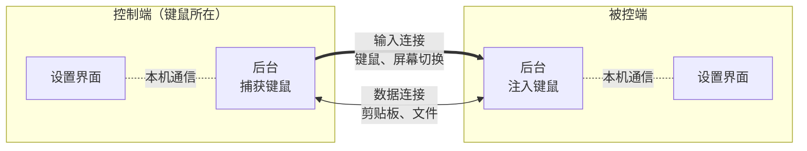
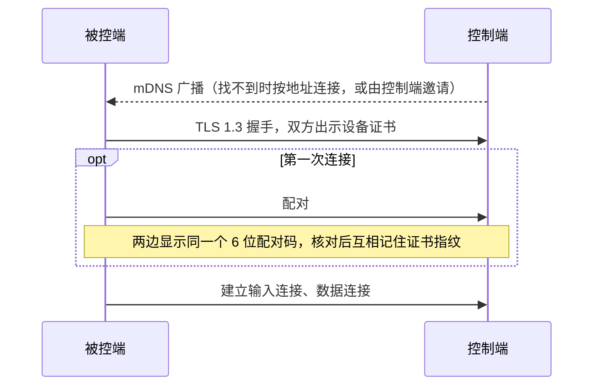
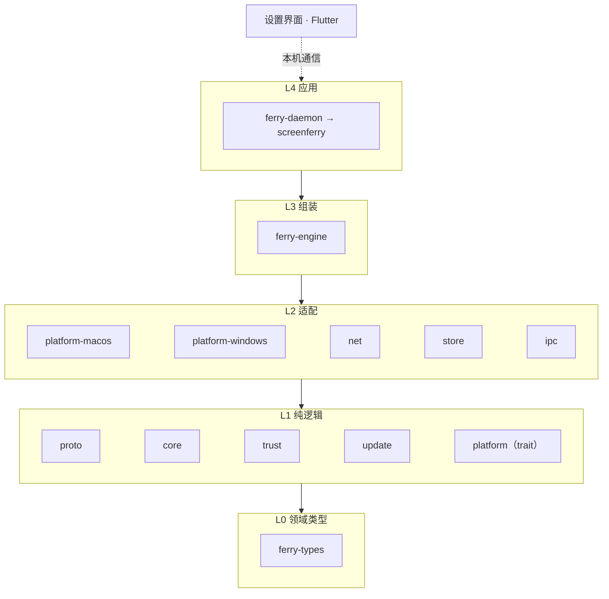

# FerryDesk

键鼠共享与双向扩展屏协作。

[](https://github.com/ccdalao/FerryDesk/actions/workflows/ci.yml)
[](#许可证)

[English](README.md) | 简体中文

FerryDesk 是一套键鼠与屏幕协作工具。它在多台电脑之间共享键鼠（Mac、Windows 任意搭配），同步剪贴板、互传文件，并把另一台电脑变成真正的扩展屏，连接全程 TLS 1.3 加密。后台命令和配置目录继续使用 ScreenFerry 名称，方便已有安装平滑升级。

由 [ccdalao（小小小龙）](https://github.com/ccdalao) 维护，基于 [ScreenFerry](https://github.com/icloudza/screen-ferry)，整合 Apollo 与 Moonlight 媒体组件。版权及许可见 [开源致谢](docs/credits.md)。

## 特性

- **键鼠共享**：光标推出屏幕边缘即切到另一台；按物理键传输，不受键盘布局和输入法影响；同步 Caps Lock，转发媒体键。
- **多台、双向**：任意一台都能当控制端，一台可以控制多台，按布局摆在上下左右。
- **剪贴板**：文字、带格式的文字、图片，光标切过去时才同步。
- **文件**：拖到屏幕边缘即发送，断线后接着传。
- **Windows 双机扩展屏**：复用现有配对，可双向扩展、暂停、恢复和传输声音。开启声音后，“被控电脑屏幕扩展主控”会把主控声音播放到被控电脑默认扬声器，反向扩展同理。扩展期间输入权由扩展窗口独占，停止扩展后恢复普通键鼠共享。
- **每台设备单独设置**：光标速度（DPI）、滚动方向与速度、修饰键与按键映射、防误切。
- **安全**：首次连接核对 6 位配对码，之后只认对方的证书指纹。
- **连得上**：局域网自动发现；网络不支持时按地址连接，或从控制端邀请。
- **轻量**：Rust 编写的后台常驻托盘；设置界面按需启动，关闭即退出。
- **自动更新**：每天检查一次，在后台下载好，你点“重启并更新”时安装；装之前先校验签名。
- **中英文**：界面、托盘菜单和安装程序有简体中文和英文，默认跟随系统，可以在“设置 → 外观”里切换。

## 工作方式



每台电脑上常驻一个后台，负责捕获或注入键鼠、网络与同步；设置界面是独立进程，经本机回环连接后台。
每对设备之间有两条 TLS 1.3 连接，传大文件不会拖慢键鼠。

首次连接时这样建立信任：



## 安装

| 系统 | 方式 |
|---|---|
| macOS | 在 [Releases](https://github.com/ccdalao/FerryDesk/releases/latest) 下载 `ScreenFerry-<版本>-macos-universal.dmg`，打开后把 ScreenFerry 拖进“应用程序”。首次运行时在「系统设置 → 隐私与安全性 → 辅助功能」中允许 ScreenFerry。 |
| Windows | 在 [Releases](https://github.com/ccdalao/FerryDesk/releases/latest) 下载 `FerryDesk-<版本>-windows-x64-setup.exe` 并运行。 |

ScreenFerry 每天检查一次更新，有新版本时在后台下载好，你方便时点“重启并更新”即可；可以在“设置 → 关于”里关掉自动检查。安装前会用内置的签名公钥校验更新。

Windows 安装包：

- 没有代码签名，SmartScreen 拦截时点“更多信息 → 仍要运行”。
- 默认装进 Program Files，也可以改到别的盘；会在防火墙中放行专用网络和域网络。
- 安装时可以勾选“允许已配对的电脑操作 Windows 权限提示（UAC）”，默认不选。勾选后会装一个只负责键鼠的系统服务，另一台电脑才能操作权限提示、锁屏和以管理员身份运行的程序；除了配对，还要管理员单独给那台电脑授权。网络、剪贴板和文件仍由普通权限的后台处理。
- 更新时弹一次管理员确认后静默安装。未启用安全输入时，要用这台自己的键鼠点确认。卸载在“设置 → 应用”，配置和配对记录保留。

## 使用

1. 两台电脑都打开 ScreenFerry。默认 Mac 控制、Windows 被控制，可以在“设置 → 这台电脑”里改。两台是同一种系统时，把没接键鼠的那台改成“被控制”。
2. 在被控端的“设备”页选中控制端，两边核对 6 位配对码。局域网里找不到时，用“按地址连接”，或在控制端“邀请一台电脑”；地址在对方「设备」页顶部。
3. 在控制端的“布局”页摆好各台的位置，把光标推出屏幕边缘即可切过去。

Windows 扩展屏需要两台都安装包含此功能的安装包，安装时勾选“启用双机扩展屏”。配对并连接后，在设备设置中选择“被控电脑屏幕作为主控的副屏”或“主控电脑屏幕作为被控的副屏”，结束时选择“取消副屏拓展”。托盘提供相同操作，快捷键可在设备设置中选择 `Ctrl+Alt+Shift+数字`，默认关闭。声音开关在下一次开启拓展时生效，网络短暂抖动时使用低延迟音频缓冲。后台直接负责串流，无需额外账号或 Apollo。

设备设置中的“副屏方案”可以保存多套配置：选择扩展哪台电脑、来源实体屏和接收屏、Windows 主显示器、扩展屏在左／右／上／下的位置、声音与独立快捷键。方案保存在创建它的电脑上，也可从托盘“扩展屏 → 方案”应用。鼠标通道随方案与 Windows 布局同步，取消拓展恢复原主屏和位置；普通键鼠布局设置保留。屏幕移除或重新编号后需编辑方案重新选择，两台都升级后才可使用方案。

若主控的管理员窗口导致无法跨屏，或需要通过副屏操作管理员窗口，请在两台电脑各自的托盘菜单选择“以管理员权限重启后台”，使用原登录账户确认 UAC。提权后菜单显示“后台已具有管理员权限”；设置窗口仍以普通权限打开。此选择仅对本次后台运行生效。普通共享的 UAC 操作继续使用单独授权的安全输入服务，副屏视频不投射 UAC 安全桌面。

首次安装虚拟显示驱动时，Windows 可能要求确认驱动发布者。允许安装后继续；失败详情位于安装程序提示的 `ScreenFerry Display Driver/install-result.txt`。

当前开发实现请求 1920×1080、最高 100 Hz。优先使用 Apollo v0.4.6 的原生 D3D11 NVENC，其他硬件可使用系统硬件编码；使用 GPU 捕获、颜色转换、解码和呈现，日志会明确记录实际后端及回退原因。实际帧率与延迟仍需双机动态画面验证，不能仅以请求档位判断性能。接收窗口覆盖所选屏幕，点击后可操作扩展桌面；UAC 或锁屏期间暂停画面，结束拓展或断线后清理本次虚拟屏。

出了问题时，在“日志 → 运行日志”里导出诊断文件，[提问题](https://github.com/ccdalao/FerryDesk/issues/new?template=bug_report.yml)时附上它。
设备名、用户名和文件名会换成代号。

光标在对方屏幕上时，按 <kbd>Ctrl</kbd>+<kbd>Option</kbd>+<kbd>Esc</kbd>（Windows 控制时是 <kbd>Ctrl</kbd>+<kbd>Alt</kbd>+<kbd>Esc</kbd>）强制回到本机。
使用前请退出其他键鼠共享软件，避免争抢键鼠。

### 命令行

| 命令 | 作用 |
|---|---|
| `screenferry` | 常驻运行：托盘图标，打开设置界面 |
| `screenferry send <文件>…` | 把文件或文件夹发给连着的电脑 |
| `screenferry peers` / `forget <设备>` | 查看、删除已配对的设备 |
| `screenferry quit` | 退出正在运行的 ScreenFerry |
| `screenferry elevate` | Windows：经 UAC 确认，以管理员身份重启后台，供主控在管理员窗口前台时捕获键鼠 |
| `screenferry serve` / `connect [地址]` | 不读配置，在终端里直接运行（调试用） |

完整选项见 `screenferry --help`。

Windows 主控的管理员窗口捕获、被控端 UAC 授权和无线延迟排查见 [修复与验收说明](docs/windows-input-repair.md)。

### 数据位置

| | macOS | Windows |
|---|---|---|
| 配置、配对记录 | `~/Library/Application Support/ScreenFerry/` | `%APPDATA%\ScreenFerry\` |
| 日志、运行时文件 | `~/Library/Caches/ScreenFerry/` | `%LOCALAPPDATA%\ScreenFerry\` |

## 从源码构建

需要 Rust（版本由 `rust-toolchain.toml` 固定，rustup 自动安装）和 Flutter 3.47。
macOS 另需 Xcode；Windows 另需 Visual Studio 2022（使用 C++ 的桌面开发）和 [Inno Setup](https://jrsoftware.org/isdl.php) 7.1 或更高版本。

```bash
cargo xtask bundle
```

在哪个系统上运行就打哪个系统的包，产物在 `target/bundle/`：macOS 是 `ScreenFerry.app` 和它的更新包 `ScreenFerry-<版本>-macos-<架构>.zip`（加 `--dmg` 另做安装盘），Windows 是 `FerryDesk-<版本>-windows-x64-setup.exe`。Windows 主程序默认安装到 `Program Files\FerryDesk`，安全输入服务及用户数据保留原技术目录以兼容授权和配对。发布用 `cargo xtask release <版本>`，见 ADR 0014。

Windows 个人构建可在打包前设置环境变量 `FERRYDESK_BUILD_LABEL`，其文字会以小字显示在左上角 FerryDesk 名称下方；不设置时只显示软件名。例如在 PowerShell 中运行：

```powershell
$env:FERRYDESK_BUILD_LABEL = '小小小龙 测试版'
cargo xtask bundle
```

macOS 上钥匙串里有 Developer ID 证书时自动签名（也可以用 `SCREENFERRY_SIGN_IDENTITY` 指定），否则用临时签名，每次重新打包都要重新授予辅助功能权限。

## 开发



每层只依赖更低的层；`unsafe` 只出现在 `ferry-platform-*` 里，按系统区分的代码只在它们和 L4 应用里。

```bash
cargo test --workspace
cargo xtask lint
```

设置界面的测试在 `app/` 下运行 `flutter test`。提交前的完整检查见 [AGENTS.md](AGENTS.md)。

| 文档 | 内容 |
|---|---|
| [AGENTS.md](AGENTS.md) | 工程规范：目录、分层、命名、测试 |
| [docs/architecture.md](docs/architecture.md) | 架构总览与 crate 依赖 |
| [docs/protocol.md](docs/protocol.md) | 线协议 |
| [docs/ipc.md](docs/ipc.md) | 设置界面与后台之间的本机通信 |
| [docs/adr/](docs/adr/) | 架构决策记录 |

## 许可证

Apollo 核心整合版按 [GPL-3.0-only](LICENSE-GPL) 发布。原 ScreenFerry 代码的 [MIT](LICENSE-MIT) 和 [Apache-2.0](LICENSE-APACHE) 许可及版权说明继续保留；这不会撤销历史代码原有的许可。

本分支已复用 Apollo v0.4.6 的原生 NVENC、RTP/FEC 分包与发送节奏，并直接编译 Moonlight common-c 的 RTP 重排/FEC 队列；实时通道包含认证加密、双向探测、关键帧恢复、码率反馈和 TCP 回退；它使用 ScreenFerry 自身的 TLS 会话和配对，不是完整 Apollo/Moonlight 产品。上游版本、对应源码、许可证和适配边界见 [第三方说明](docs/third-party-media.md)。安装包随附许可证与完整构建源码压缩包 `source.zip`。

## 友情链接

- [LINUX DO](https://linux.do/)

扩展屏支持暂停／恢复快捷键；屏幕布局和每个扩展屏方案均可独立保存物理接缝对齐尺。热点拥塞时优先降低画质以保护鼠标响应。
